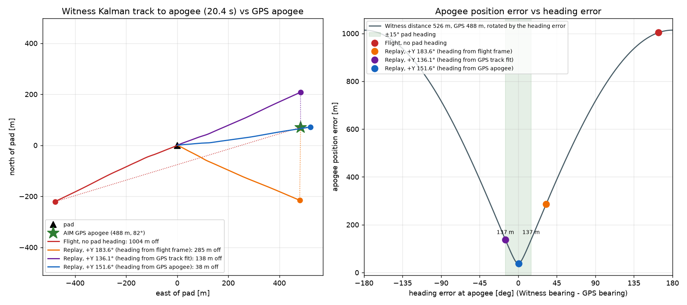

# Witness flight analysis, 2026-11-21 (session 3E1)

**Sources:**
- Witness flash logs in `flightreal/`, decoded to CSV with `Software/Horizon/converter.py`: `I00003E1.csv`, `S00003E1.csv` and `P00003E1.csv`.
- Witness radio telemetry received by Horizon at 2 Hz (`flight logs/horizon_witness_20261120_220013_773983.jsonl`).
- Blue Raven LR log, used as the altitude reference.
- AIM CSV export.

**Time base:** all times are seconds from liftoff. Liftoff is the Raven's `Flight_Time` 0, at 13:47:32.634 local. Telemetry is timed by host receive time, which runs about 0.3 s late (see section 1).

## Summary

1. **The Kalman filter worked well on the IMU alone during the ascent.** It had no barometer and no GPS.
   - Apogee: 2619.5 m against the Raven's 2580.1 m, an error of +39 m (+1.5 %), at the same time to within receive latency.
   - Coast altitude error: 23 m RMS once the 0.32 s telemetry latency is allowed for.
   - Vertical speed against the Raven's baro slope: −3.4 m/s mean and 6.6 m/s RMS during the coast.
   - Peak vertical speed: 356.8 m/s against 351.7 m/s from the Raven.
2. **The filter's attitude was lost at the apogee ejection, and it never recovered.**
   - At about 19.5–20.0 s the Witness IMU saw 199 g on the high-g accelerometer and 2,293 dps on the gyro (the logged maximum). The AIM fired its apogee output at 19.2 s.
   - The attitude estimator gives up for the rest of the flight once the gyro passes 1,950 dps. From then on the position filter predicts without the IMU (`kf_imu_ignored` = 1 in every packet log record).
   - With no barometer or GPS to correct it, the velocity froze at the last value before the loss: (−24.7, −13.8, −2.4) m/s east/north/up. Position then drifted linearly, at 2.4 m/s downward and 28 m/s sideways.
3. **Descent came 53.5 s late, and Landed never came.**
   - The state machine declared Descent at 73.8 s, when the frozen altitude had fallen to 95 % of its maximum (2619.5 → 2488 m at 2.4 m/s).
   - The true apogee was at 20.3 s.
   - The Raven landed at about 154 s, while Witness's altitude was still 2,307 m.
   - Landed was never detected: Witness stayed in Descent for about 45 minutes after landing, and its altitude drifted to −5,000 m.
4. **The barometer and GPS gave the filter nothing for the whole flight.**
   - MS5607: `barometer_valid` = 0 and pressure 0 in every S record. The text log has 7,982 `PROM CRC mismatch` errors and BIT `3.1 baro ready: FAIL` (blocking). The barometer was already failing in the earlier session 3E2, so the board flew with a blocking BIT failure.
   - GPS: `gps_locked` = 0 throughout, 0 satellites, and no GPS origin.
5. **Brownout resets on the ground ended the log.**
   - The battery read 3.10–3.21 V on the pad, about 3.06 V after landing and 2.94–3.00 V at the end. That's a nearly empty 1S Li-ion from the start.
   - From about 1,950 s, Witness reset every 2.1 s: 315 resets in total, with `last reset BROWNOUT` in the text log.
   - Never detecting Landed kept it in the full-rate flight mode, with the radio transmitting, which drained the battery further.
6. **Logging:**
   - The IMU log (`I`) and the sensors log (`S`) cover the whole flight.
   - The packet log (`P`, Kalman filter and state at 50 Hz) only covers from 373 s onward. The resets restarted its launch protection, and the ring then overwrote the ascent. This is audit item 9 (packet ring after a reset in flight) happening for real.
   - The in-flight Kalman data in this report comes from the 2 Hz radio telemetry, which arrived without a gap from liftoff to landing.

## 1. Flight timeline

| Event | Raven | AIM | Witness (state) |
|---|---|---|---|
| Liftoff / Boost | 0.00 | 0.00 (defined) | 0.31 (telemetry), 0.00 (I log) |
| Burnout / Coast | 1.14 | 1.19 | 1.41 (I log), 1.80 (telemetry) |
| Apogee | 20.12 flag, 20.28 max baro | 19.21 (state + output A) | filter max 19.82; Descent declared 73.80 |
| Apogee charge | 21.66 | 19.21 to 20.21 (A on) | IMU shock 19.5–20.0 |
| Main | 135.2 | | |
| Landing | about 154 (log ends 153.8) | | never |

Burnout came 1.41 s after Boost in the I log, against 1.14 s on the Raven. Witness ends Boost only after axial acceleration has been under 1 g for 500 ms, so the extra 0.27 s is expected.

## 2. Kalman filter during the ascent (IMU only)

Telemetry `kalman_altitude` and `velocity[2]`, compared with the Raven's baro AGL and a baro-derived vertical speed (0.5 s smoothing):

| ft (s) | Kalman alt (m) | Raven alt (m) | Kalman vz (m/s) | Raven baro vz (m/s) |
|---|---|---|---|---|
| 2.8 | 842 | 756 | 271 | 299 |
| 4.8 | 1316 | 1249 | 207 | 219 |
| 8.8 | 1971 | 1921 | 127 | 131 |
| 12.8 | 2367 | 2323 | 74 | 75 |
| 16.8 | 2573 | 2531 | 30 | 31 |
| 19.8 | 2620 (max) | 2577 | 0.6 | about 0 |

- **Altitude:** the error is +43 to +50 m through the coast with no time shift applied. With the best-fit shift of 0.32 s (receive latency plus the 2 Hz sample timing), it's 23 m RMS. The remaining offset builds up during the boost: −42 m to +107 m while the samples are only 0.5 s apart and the vehicle moves 350 m/s.
- **Vertical speed:** −3.4 m/s mean and 6.6 m/s RMS against the baro slope from 2 to 19.9 s. The largest error, 28 m/s, is right after burnout, where the baro slope is least trustworthy.
- **The Raven's own `Velocity_Up`** reads about 26 m/s lower than its baro slope during the coast, and crosses zero 3 s before its baro apogee. It isn't a good truth for vertical speed, so the baro slope is used instead.
- **Horizontal velocity** was about 28 m/s by the end of the burn, and position 520 m from the pad at apogee. Witness reported this as south-west, but no pad heading was set, so the direction was arbitrary: the GPS track went east (see section 7).

**Conclusion:** the IMU-only prediction and the GPS trust ramp code did their job up to apogee. The weak point is what happens after the attitude is lost.

## 3. Kalman filter after the attitude loss

- **First telemetry without attitude:** 20.32 s (quaternion all zeros). Every later packet shows velocity (−24.7, −13.8, −2.4) m/s.
- **Altitude error grows linearly:** +39 m at 20.3 s, +96 m at 24.8 s, 1,146 m mean and 2,254 m maximum by 150 s. The real descent rate was about 46 m/s; the filter believed 2.4 m/s.
- **Packet log Kalman records** (`P`, 373–2,719 s):
  - `kf_initialized` = 1 and `kf_imu_ignored` = 1 throughout.
  - `baro_updates`, `gps_updates` and the reject counters are all 0.
  - `position_sigma_z` grows from 36 km at 380 s to 321 km at 1,500 s. It falls back to about 500 m after the resets, because each reset restores the position but not its uncertainty.
- **Why the velocity freezes:** `predict_without_imu()` assumes zero net acceleration and only adds process noise, expecting the barometer and GPS to correct the state. With neither working, the velocity estimate from before the loss is held for the rest of the flight.
- **Each warm reset** restored the filter with "no attitude: baro/GPS only", as designed. A reset can't bring the attitude back in flight.

## 4. Sensors and IMU

| Item | Value |
|---|---|
| Boost peak, high-g accelerometer | 47.6 g on x (the low-g accelerometer clips at 16 g) |
| Boost roll rate | Up to about 1,216 dps on x, below the 1,950 dps limit |
| Apogee shock | 199 g on the high-g accelerometer; gyro 2,293 dps on x and 2,137 dps on y (clipped) |
| Gyro after the shock | 400–800 dps of tumbling under the parachute |
| `lsm6_temperature` | 62–65 °C for most of the log, which needs a look: either the board ran hot or the temperature scale is wrong |
| IMU FIFO (text log, after the resets) | 918 Hz, about 300 overruns per 10 s, longest sensor-task pass 24.8 ms, "spikes rejected 181" |

## 5. Things to fix (proposals, not done)

1. **Don't give up the attitude for good after a short saturation.** For a shock that saturates for a few samples, re-initialise the attitude once the rates settle. In descent the attitude can be rebuilt from gravity whenever the vehicle is momentarily quiet, or the filter can fall back to the |f| magnitude mode.
2. **Bound the velocity when the IMU is ignored and there's no barometer or GPS.** Decay it towards zero, or after apogee towards a typical descent rate, instead of holding the last value. And give a Landed fallback by time since apogee when no altitude source is valid.
3. **Make the flight software depend on a working barometer.** A blocking BIT failure (`3.1 baro ready`) and a not-locked GPS on the pad should stop a launch. This board's MS5607 has failed its startup check since at least session 3E2.
4. **Protect the battery:** start with a full charge (it was 3.1–3.2 V on the pad). Once on the ground for long, or below about 3.2 V, enter a low-power mode, and make sure Landed can be detected without altitude.
5. **Make the packet-ring launch protection survive a reset** (audit item 9), so the ascent isn't overwritten.
6. **Check the IMU temperature reading** (62–65 °C) and the sensor-task pass time (24.8 ms, FIFO overruns).

## Files

- CSVs: `flightreal/I00003E1.csv`, `S00003E1.csv`, `P00003E1.csv` (converter output; `P` is on its own clock, starting 373 s after liftoff).
- Analysis scripts: in the session scratchpad (pandas, Logs `.venv`). The telemetry comparison uses the Horizon JSONL `state` packets.

## 6. Bench replay of the flight IMU (2026-11-22)

**What was replayed:** the flight's recorded IMU (`I00003E1.csv`) was played into the bench Witness over HITL with `Software/HITL/replay_flight.py`. The run folder is `Software/HITL/runs/20261122-004116`.
- **Rate:** 960 Hz. The 1-in-10 Descent records were interpolated back to 960 Hz.
- **Conditions as in the flight:** pressure 0 (barometer invalid) and no GPS fix.
- **Pad:** a 20 s pad hold made by repeating the quietest 0.5 s of the recorded pre-launch data.
- **Firmware:** the bench image `a443972`. The flight board ran `c790b78-dirty`, which has the same filter code.

**Result: the failure was reproduced.**

| | Flight (telemetry) | Bench replay (packet log, 50 Hz) |
|---|---|---|
| Boost / Coast | 0 / 1.41 s (I log) | 0 / 1.43 s |
| Kalman apogee | 2619.5 m at 19.82 s | 2652.5 m at 19.92 s (Raven 2580.1 m) |
| Attitude lost | 19.9–20.3 s | 19.98 s: "gyro saturated (\|rate\| >= 1950 dps on an axis for 2 samples): attitude tracking stopped for this flight" |
| Frozen velocity (E, N, U) | (−24.7, −13.8, −2.4) m/s | (−25.9, +10.3, −0.5) m/s |
| Descent | 73.8 s | not reached in the 220 s replay |

**Why Descent differs:**
- The velocity held after the loss is whatever the filter had at the last IMU step, and its vertical part is small and random: −2.4 m/s in flight, −0.5 m/s on the bench.
- At −0.5 m/s, the 95 % altitude rule (a 133 m drop) would only fire at about 285 s. The flight's −2.4 m/s gave 73.8 s.
- So whether, and when, Descent is declared after an attitude loss depends on a near-zero leftover velocity. It isn't a reliable apogee detector.

**Horizontal velocity:** about 28 m/s in both, but in a different direction. The heading isn't known on the pad, so it is arbitrary here and in the flight.

**Ascent agreement:** the replay's ascent matches the flight telemetry closely: 237 m / 370 m/s at 0.8 s against 196 m / 357 m/s.

**Conclusion:** the bench can now reproduce this flight on demand, which makes it a regression test for the fixes in section 5:
- recover the attitude after a short saturation;
- don't hold the velocity when no altitude source is valid;
- detect apogee or Landed without a barometer.

### 6.1 Replay with the flight board's IMU calibration (run `20261122-011558`)

**What changed:** the flight board had a stored IMU calibration; the bench board has none. The first replay therefore fed the filter uncalibrated data.
- The flight board's text log shows its calibration: gyro bias −0.28 / 0.07 / −0.07 dps; low-g offset 0.3 / −9.9 / 10.9 mg and scale 0.9973 / 0.9982 / 0.9964; high-g offset 54 / −136 / −23 mg and scale 1.0022 / 1.0041 / 1.0082.
- `replay_flight.py --calibration-from S00003E1.TXT` now applies that calibration to the replayed 960 Hz data, the same way Witness's `imu_calibration::apply` does, so the bench filter sees the same inputs as the flight.

**Result:**

| | Flight | Replay, no calibration | Replay, flight calibration |
|---|---|---|---|
| Kalman apogee | 2619.5 m at 19.82 s (receive time) | 2652.5 m at 19.92 s | **2621.6 m at 19.74 s** |
| Altitude difference to the flight, 2–19.5 s | — | 16.8 m RMS | **2.1 m RMS** (0.12 s receive latency) |
| Vertical speed difference, 2–19.5 s | — | 0.84 m/s RMS | **0.18 m/s RMS** |
| Attitude lost | about 19.9–20.3 s | 19.98 s | 19.98 s |
| Frozen vertical velocity | −2.4 m/s | −0.5 m/s | **−2.4 m/s** |
| Frozen horizontal speed | 28.3 m/s | 27.9 m/s | 28.4 m/s (direction arbitrary) |
| Boost → Coast | 1.41 s | 1.44 s | 1.43 s |
| Descent | 73.5 s (Witness clock), 73.8 s (telemetry) | not reached | **76.3 s** |
| Landed | never | never | never |

**Reading the result:**
- With the flight calibration applied, the bench reproduces the flight's Kalman filter to within about 2 m and 0.2 m/s up to apogee, and exactly reproduces the frozen velocity after the attitude loss.
- Descent comes 2.8 s later than in flight. The replay's altitude is 8 m higher after apogee, and at 2.4 m/s that's 3.5 s to the 95 % threshold.
- The 30–40 m difference early in the boost table is the flight telemetry's receive latency (about 0.12 s at 350 m/s), not a filter difference.
- **The calibration matters:** without it, the filter's apogee moved by 33 m and the leftover vertical velocity by 1.9 m/s, enough to stop Descent from happening at all.

**This replay is the regression test for the fixes.** Command:

`py -3.14 replay_flight.py <I*.csv> --raven <Raven LR csv> --calibration-from <S*.TXT>`, on a bench board without a stored calibration.

## 7. Horizontal direction: no pad heading was set (2026-11-24)

**Finding:** the Kalman track went almost the opposite way from the GPS because Witness had no heading, not because a heading was entered wrong.
- No pad heading command (`0x4844`, Horizon's "Set pad heading…") was sent: there is no command in the Horizon log and no "pad heading applied" line in `S00003E1.TXT`.
- Witness has no magnetometer. On the pad it initialises its attitude from gravity alone (shortest-arc rotation onto +Up), so tilt is known but heading is not: the board's +Y axis is taken as north.
- Its GPS heading alignment could not help either: the receiver had no fix in flight.

**Track against the AIM GPS (from the pad, bearings clockwise from true north):**

| Flight time | Witness (telemetry) | AIM GPS |
|---|---|---|
| ~8 s | 247 m at 247° | 177 m at 15° |
| apogee (19–20 s) | 486 m at 245° | 488 m at 82° |
| after apogee | velocity frozen at 241° | 675–1,020 m at 75–84° |

- The distance agrees within 2 m at apogee: the filter measured the sideways motion; only its frame was rotated.
- The flight track has to turn about 164° to reach the GPS apogee. That does **not** give the rail heading directly, because the flight board's "north" was not its +Y axis (see 7.1); the replay puts the board's +Y axis at about **152° true**.
- The GPS track's side-to-side detail before apogee is not trusted (it bends north-west then east); only its apogee position is used.

**Fix for the next flight:** set the pad heading before launch (a body axis across the rocket, +Y/−Y/+Z/−Z, and its compass bearing). With a GPS fix in flight, Witness would also correct it.

### 7.1 HITL replay with the pad heading set (runs `20261124-133524`, `-134423`, `-135321`)

**Method:** `replay_flight.py --pad-heading +Y:DEG` (new option) sends the pad heading command 6 s into the pad hold, as Horizon's "Set pad heading…" would. Witness confirmed each one (`pad heading applied: body +Y at 183.6 deg (turned +176.3 deg)`). The GPS track's side-to-side detail is not trusted, so the only horizontal truth used is the **AIM GPS apogee position: 488 m from the pad at 81.7°, 20.43 s after liftoff**. Liftoff for the AIM is taken from its acceleration jump; its Boost state comes 0.64 s late.

| Case | Witness apogee | Bearing error | Position error at apogee |
|---|---|---|---|
| Flight, no pad heading | 526 m at 245° | +164° | 1004 m |
| Replay, +Y at 183.6° | 525 m at 114° | +32° | 285 m |
| Replay, +Y at 136.1° | 526 m at 67° | −15° | 138 m |
| Replay, +Y at 151.6° | 526 m at 82° | +0.4° | **38 m** |

**Reading the result:**
- The heading command works exactly: every replay is the same track rotated by the heading change (183.6° → 136.1° moved the apogee bearing by 47.5°), and nothing else changed.
- **The heading that matches the GPS apogee is +Y at about 152° true.** That value comes from the GPS apogee itself, so the bearing match in the last row is by construction. The independent result is the **distance: 526 m against 488 m, 38 m (8 %) long**, which is the filter's own horizontal error once the heading is right.
- **A ±15° pad heading would put the apogee about 140 m off** (right panel of `heading_apogee_error_2026-11-21.png`). Without a heading the error can be anything up to about 1 km.
- The first guess, 184°, assumed the flight board's +Y axis was its "north". It wasn't: Witness sets up its attitude the first time it is still on the pad, and the frame then follows the gyro. If that happened before the rocket was raised on the rail, "north" ends up wherever the raise turned it. **Send the pad heading after the rocket is vertical on the rail.**
- Replay detail: this firmware reached Landed (sim 241.6 s) in the first run; the flight never did.

### 7.2 Cross-check: pad heading from the AIM magnetometer (no GPS)

**Method:** the AIM's pad magnetometer and accelerometer (9 s before liftoff, 10 Hz) were rotated into Witness's frame with the mapping found earlier (`x=z,y=x,z=y`, roll +5.8°). The local declination, dip and field strength come from the World Magnetic Model, computed offline (the site isn't recorded here).

**Axis checks:**
- **Cross axes OK:** over the coast the rocket rolled +444° (AIM gyro) and the measured cross-axis field turned −452°, slope −1.00 as it should.
- **Sign:** the measured dip came out with the opposite sign to the model's, so the field is reversed. Integrating the AIM gyro from the pad and checking which version of the field stays fixed in the world as the nose pitches over (up to 56°): every axis reversed (or as logged), median 15° drift; only the nose axis reversed, up to 111°. With the dip sign, the AIM's magnetometer reports the field with **every axis reversed** relative to its accelerometer.
- **Hard iron:** a circle fit to the cross-axis field during the coast roll gives an offset of 22 % of the field; after removing it the dip is within 1.2° of the model's.

**Result:**

| Source | Board +Y axis on the rail (true) |
|---|---|
| AIM magnetometer, as calibrated by the flight's roll | **153.1°** |
| AIM magnetometer, no hard-iron correction | 144.3° |
| HITL replay fitted to the GPS apogee (7.1) | 151.6° |

**Reading it:** a magnetometer on the pad would have given the heading to within about 2° (7° without calibration), both well inside the ±15° that keeps the apogee within about 140 m. The AIM-to-Witness roll alignment (±a few degrees) is the largest remaining uncertainty. **A magnetometer on the next Witness revision is worth it.** Calibrate it in the rocket (a gyro-tracked rotation), and check its field strength and dip against the World Magnetic Model at the pad before trusting it.
