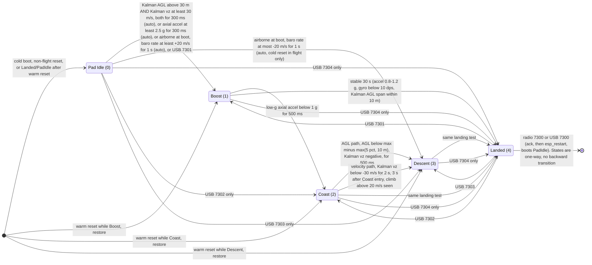
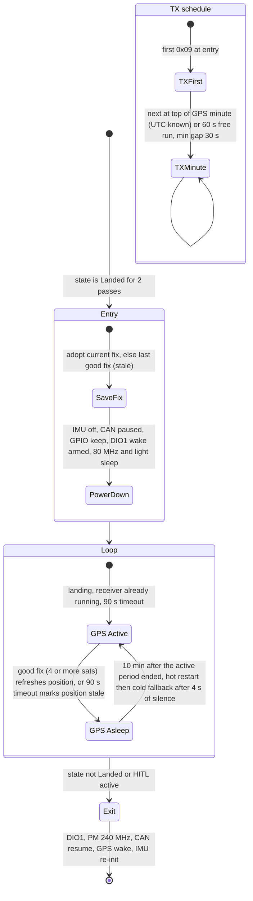
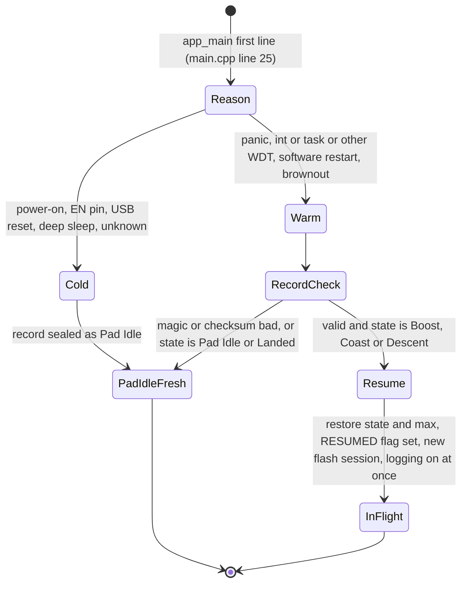
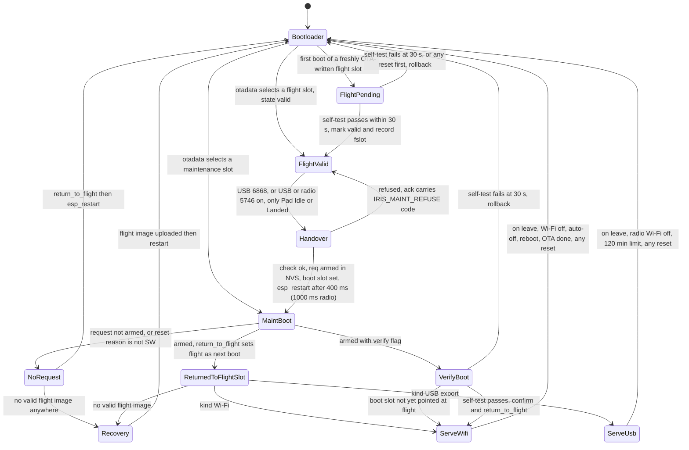
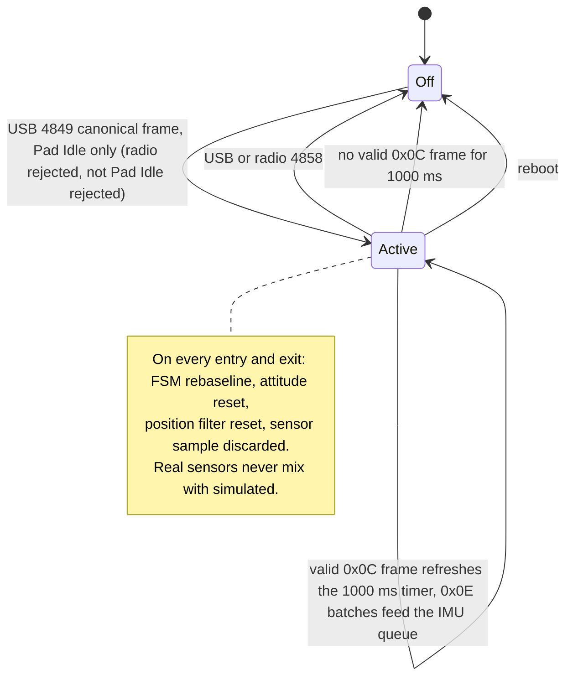
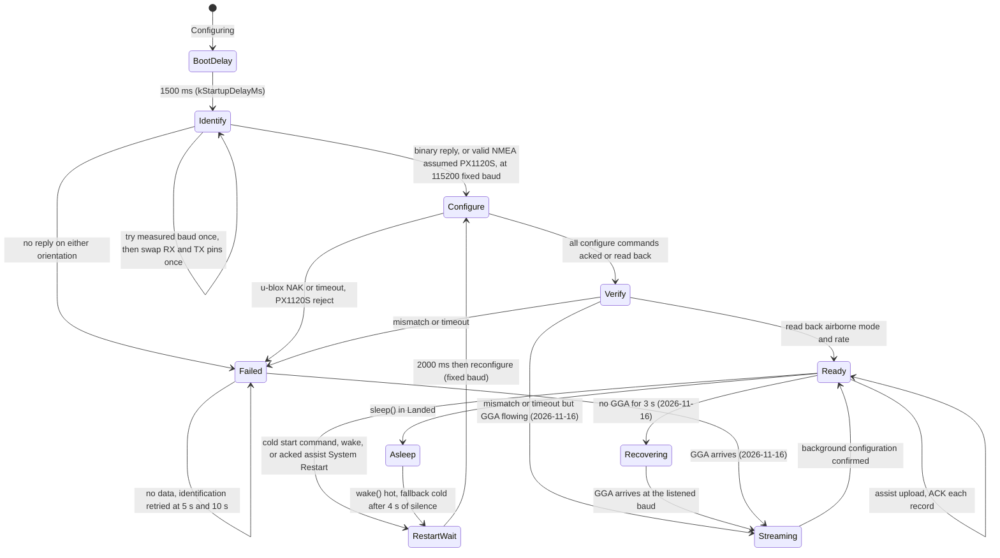
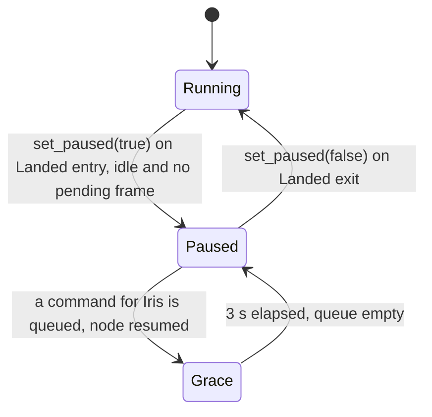

# Witness firmware: state machines, transitions and command gating

Generated 2026-11-14 by a read-only review of the working tree (including the
uncommitted Landed low-power mode and Pad Idle 3 s radio rate). Nothing was
built, flashed or run; every statement is from reading source. Where the
documents (`FIRMWARE_HANDOFF.md`, `GROUND_STATION_PROTOCOL.md`, `comms.h`
comments) disagree with the code, the code is treated as truth and the
disagreement is listed in "Findings".

**Updated 2026-11-15 to the code after the FSM rework:**
- launch, descent and landing on Kalman AGL;
- barometer held out through Coast;
- radio power and GPS assist refused in Boost;
- flight data never erased, with erase/clear allowed over radio;
- GPS time slots and the uplink hold-off.

**Changed 2026-11-16.** Sections changed: 1 (Boost has three routes: Kalman AGL
and velocity, axial acceleration 2.5 g, and airborne at boot; the diagram and
A1 row; the "not present" list); 4 (warm reset keeps AGL, vertical velocity, pad
gravity and pad references; a cold reset in flight is detected by the airborne
rule); 6.3 (GPS receiver states Ready, Streaming, Recovering and Failed; Failed is
no longer terminal while data flows); 8 (a status table with FIXED or STILL OPEN
for every finding, and the findings table of fix reports). The fix reports are in
`Software/AUDIT/2026-11-15/fixes/` (04 for the flight state machine and filter, 05
for GPS, 06 for commands, 03 for boot and supervision). Constants were checked in
`main/flight_state_machine.h` and `main/command_policy.h`. Not bench verified.

Section 1, the command rows in section 7 and the findings marked "Status
2026-11-15" reflect the new code. File:line references outside section 1 are
from the 2026-11-14 tree and may have shifted. The quick reference for every
command and packet is `Software/COMMANDS_AND_PACKETS.md`.

Conventions: paths are relative to `Software/Witness/softwarev1/main/` unless
they start with a document name. `file:N` is a line number in the working tree.
"Radio" means LoRa, "USB" means the USB Serial/JTAG command path.
"Unverified" means inferred from reading, not seen on the bench.

Contents

1. Flight state machine (Pad Idle, Boost, Coast, Descent, Landed)
2. What each state does (radio, logging, LED/buzzer, CAN, sensors, power)
3. Landed low-power sub-machine
4. Reset and resume behaviour (every state)
5. Image and boot state machine (flight/maintenance, four slots, OTA, rollback)
6. Side modes: HITL, USB export, Wi-Fi window, GPS receiver, CAN pause
7. Command gating table
8. Findings, ranked by severity

---

## 1. Flight state machine

Five states, `FlightStateMachine::State` (`flight_state_machine.h:21-27`):
Pad Idle 0, Boost 1, Coast 2, Descent 3, Landed 4. There is no armed, abort,
apogee, drogue or maintenance state in the flight image (maintenance is a
separate image, section 5). The state is a 3-bit field in status byte 1
(`comms.h:163`). `update()` is called from the sensor task on every pass that
has a new IMU, barometer or battery sample (`sensors.cpp:2362-2401`, about
500 Hz). Automatic transitions are compile-time on
(`flight_state_machine.h:31`). Landed is the only state `update()` never leaves.

### 1.1 Automatic transitions

| # | Transition | Trigger and thresholds | Debounce / glitch handling | Source |
|---|---|---|---|---|
| A1 | Pad Idle to Boost | `agl_valid` and Kalman AGL (`position_filter_.up().p`, metres above the pad) strictly above **30 m** (`kLaunchAglMeters`) **and** a valid Kalman vertical velocity of at least **30 m/s** (`kLaunchVerticalVelocityMps`, 2026-11-15) | **300 ms** consecutive (`timestamp_us`); one non-qualifying observation resets it. Calls `trigger_launch()`, the same path as a commanded launch | `flight_state_machine.h` constants; `flight_state_machine.cpp` `update()` PadIdle case; input `sensors.cpp` observation block |
| A1b | Pad Idle to Boost, axial acceleration (2026-11-16) | Filtered axial acceleration (body +X, `axial_acceleration_g`) at or above **2.5 g** (`kLaunchAccelerationG`). Needs no attitude and no position filter | Leaky budget: time above the threshold fills it at real time, below the threshold it drains **2x** as fast (`kLaunchAccelerationDrainFactor`), credit per observation capped at 50 ms. Fires when the budget reaches **300 ms** (`kLaunchAccelerationQualificationMs`). Log: "launch detected: axial acceleration" | `flight_state_machine.h` lines 51-63; `acceleration_launch_detected` |
| A1c | Pad Idle to Boost or Descent, airborne at boot (2026-11-16) | Raw barometer rate (`position::BaroRate`, independent of the filter): at least **+20 m/s** (`kAirborneRateMps`) gives Boost; at most **-20 m/s** gives Descent | **1 s** (`kAirborneQualificationMs`). Only in Pad Idle. Both mark the flight as real (`flight_inferred_`). Log: "airborne at boot". Above about Mach 0.8 the raw baro is wrong, so a cold reset in supersonic flight may be classed late or by the wrong sign | `flight_state_machine.h` lines 65-72; `position_filter.h` BaroRate; `sensors.cpp` `service_position` |
| A2 | Boost to Coast | `low_g_axial_acceleration_valid` and **raw, unfiltered** low-g X below **1 g** | **500 ms** consecutive; any one sample at or above 1 g (or low-g invalid) resets the timer | unchanged |
| A3 | Coast to Descent, AGL path | Kalman AGL below `max - max(0.05 * max, 10 m)` (`kDescentMinimumDropMeters`), maximum valid and positive, Kalman vertical velocity negative | **500 ms** consecutive; the timer resets whenever the maximum rises | `flight_state_machine.cpp` Coast case |
| A4 | Coast to Descent, velocity path | Kalman vertical velocity below **-30 m/s**, `climb_seen_` (above **+20 m/s** seen in Boost/Coast; true after a restore), at least **3 s** since Coast entry. Now always available, not only when the barometer is gated | **2 s** consecutive | `flight_state_machine.cpp` Coast case |
| A5 | Boost / Coast / Descent to Landed | Acceleration magnitude 0.8 to 1.2 g, gyro magnitude below 10 dps, Kalman AGL valid, AGL span over the window at most **10 m** | **30 s** consecutive, evaluated before the per-state switch | `flight_state_machine.cpp` `landing_detected()` |

Altitude source: **only** the position filter's height above the pad (AGL) and
vertical velocity. The raw barometer, the MSL pressure altitude, the median
window and the climb-rate limit were removed on 2026-11-14. The filter pins AGL
to 0 while still on the pad, rejects barometer outliers with its innovation gate,
gates the barometer from Mach 0.8, and once gated in Boost or Coast keeps it out
until Descent (`position_filter.cpp` `update_baro`). The maximum AGL is tracked in
Boost and Coast only and persisted with the state.

Bench: HITL "Nominal 10 g" on Witness (2026-11-15). Every transition came
within 0.03 s of `HITL/sim_model.py` `ReferenceStateMachine`, which uses the
simulated true AGL and vertical velocity. The Kalman AGL error was at most
2.8 m.

State entry bookkeeping (`reset_for_state`, `flight_state_machine.cpp:209-237`):
every transition clears the dwell timer and the velocity timer. Coast entry
stamps `coast_entered_us_`. Pad Idle and Boost entry clear `climb_seen_` and
set the tracked maximum to the current altitude (so a prelaunch pressure spike
cannot make Descent unreachable). Pad Idle and Landed entry clear the landing
window. Coast and Descent entry from a command do not reset the maximum.

### 1.2 Commanded transitions (0x7300-0x7304)

Entry points: USB `process_canonical_binary_command` (`usb_serial_echo.cpp:461-465`),
USB compact `05 73 0X` (`usb_serial_echo.cpp:482-483`), USB ASCII `05 73 0X`
(`usb_serial_echo.cpp:669-673`), radio switch (`usb_serial_echo.cpp:595-602`).
All go through `command_policy::allow_set_flight_state`. **Since 2026-11-15 the
states are one-way**: `FlightStateMachine::set_state` itself refuses a lower
state (`ESP_ERR_INVALID_STATE`), and the policy refuses it first:

* Radio: only current Landed and requested Pad Idle (the reset below) and Pad
  Idle to Pad Idle (no-op). Everything else, including any launch, is refused
  (ack `IRIS_ACK_REFUSED`).
* USB: requested above 4 is refused. From Boost, Coast or Descent only Landed
  (or the same state) is accepted. From Pad Idle any of 0..4. From Landed only
  Landed (same) or the reset to Pad Idle.
* **Reset:** `0x7300` while Landed (USB or radio) is acked OK, then
  `UsbSerialEcho::set_flight_state` schedules `esp_restart()`
  (`maintenance_mode::restart_after_ms`, 0.4 s USB, 1 s radio). A persisted Landed
  is not resumed (`flight_state_store::resumable`), so the boot is Pad Idle with a
  fresh position filter and log session. Boost, Coast and Descent are still resumed
  after a reset.
* USB Pad Idle to Boost uses `trigger_launch()` (`usb_serial_echo.cpp:1060-1068`).
  Any other accepted value uses `set_state()` (no state-specific entry action
  beyond `reset_for_state` on the next `update()`).
* A commanded state does not disable automatic transitions
  (`FIRMWARE_HANDOFF.md:714-716`; confirmed, there is no latch).

Resulting matrix (rows current state, columns requested; U = USB only,
R+U = radio and USB, "same" = no-op accepted, x = refused):

| current \ requested | 7300 Pad Idle | 7301 Boost | 7302 Coast | 7303 Descent | 7304 Landed |
|---|---|---|---|---|---|
| Pad Idle | R+U same (no-op) | U (launch trigger) | U | U | U |
| Boost | x | USB same; radio x | x | x | U |
| Coast | x | x | USB same; radio x | x | U |
| Descent | x | x | x | USB same; radio x | U |
| Landed | R+U (ack, then restart) | x | x | x | USB same; radio x |

Persistence: every state change calls the persist callback
(`flight_state_machine.cpp:34-37`, installed `main.cpp:38`). A commanded
Boost, Coast or Descent is therefore also resumed after a warm reset (section 4).

### 1.3 Debounce summary and missing transitions

* No hysteresis anywhere: each qualifying timer is "consecutive observations
  satisfy the predicate", and one failing observation restarts it
  (`flight_state_machine.cpp:93-109`). Launch uses the filtered signal; burnout
  uses the raw low-g sample; landing uses raw low-g magnitude and gyro.
* Not present: Coast to Boost (re-ignition, airstart, staging), Descent to
  Coast, Pad Idle to Landed (auto), Pad Idle to Coast (auto), Pad Idle to
  Descent except through the airborne rule A1c (auto), any
  timeout (Boost, Coast, Descent can last forever), any automatic exit from
  Landed, any Landed re-detection from Pad Idle.
* Unreachable by automatic means: Landed to anything. Pad Idle after Landed is
  reachable only by command.

---

## 2. What each state does

"Radio" below is the scheduled telemetry rate. Immediate-queue frames (command
acks, USB relays) are never throttled.

| Item | Pad Idle | Boost | Coast | Descent | Landed |
|---|---|---|---|---|---|
| Radio sensors 0x01 and state 0x02 | one each per **3 s** (`landed_logic.h:19,28-36`, applied `sensors.cpp:1460-1462`) | 1 Hz each (`sensors.h:78-80`) | 1 Hz | 1 Hz | none scheduled |
| Radio camera 0x03 (CAN relayed) | 1 Hz (`landed_logic.h:20`) | 1 Hz | 1 Hz | 1 Hz | none (CAN paused) |
| Other radio traffic | acks, replies | same | same | same | 0x09 landed position packet, first at entry then top of each GPS minute (60 s, never closer than 30 s), plus ping replies (5 s limit) and acks (`sensors_landed.cpp:288-318`, `landed_logic.h:46-47,51`) |
| Radio RX | continuous after each TX | same | same | same | continuous RX, DIO1 wakes the MCU from light sleep (`sensors_landed.cpp:231-242`) |
| Binary sensor/IMU logging to NAND | off (`flight_state_machine.h:11`); RAM prelaunch ring 2 s (sensor 50 Hz ring, IMU 960 Hz ring) (`flash_logger.cpp:618-622,906-916`) | on; first record dumps the prelaunch ring and writes the flight marker (`flash_logger.cpp:922-943,631-641`) | on | on; IMU log decimated to every 10th record, about 96 Hz (`flash_logger.cpp:644-648`, `flash_logger.h:29`) | off (`flight_state_machine.h:15`) |
| Text log, raw GPS UART, packet stream | on (circular on the pad) | on, ring protected from the launch point (`flash_logger.cpp:176-182`) | on | on | text and GPS bytes still flush; sensor/IMU capture tasks sleep (`flash_logger.cpp:881-886,1080-1084`) |
| LED | red LED pulse 100 ms each second (`heartbeat.cpp:251-269`) | same | same | same | silent without USB host (`heartbeat.cpp:303-308`) |
| Buzzer (compiled **off**, `heartbeat.cpp:6`) | 75 ms chirp every 5 s | 700 ms every 1 s | two 100 ms | three 100 ms | two 250 ms tones every other second; **silenced** by low-power mode without a USB host (`heartbeat.cpp:199-249`) |
| Heartbeat packet (USB) and CAN heartbeat | 1 Hz | 1 Hz | 1 Hz | 1 Hz | none (no USB host) / CAN paused |
| CAN relay (Iris 0x03, debug, command packets to USB/radio cache) | active, 500 kbit/s | active | active | active | **paused**: node disabled; a radio command for Iris re-enables it for 3 s (`can_link.cpp:156-186`, `landed_logic.h:59`) |
| IMU LSM6 (960 Hz FIFO) | on | on | on | on | powered down after 2 normal passes, full re-init on exit, up to 3 tries (`sensors_landed.cpp:143-167,221`, `sensors.cpp:2472-2484`) |
| Barometer MS5607 (about 50 Hz) | on | on (gated for FSM when position filter gates it) | on | on | not polled |
| GPS UART, 25 Hz, 115200 | on | on | on | on | duty cycled: sleep on a good fix or after 90 s, wake every 10 min (`landed_logic.h:48-50,163-210`) |
| Attitude, position Kalman | on, pad bias windows, pad heading | on | on | on | not run |
| MCU clock and sleep | 240 MHz, no sleep | same | same | same | 80 MHz, automatic light sleep unless a USB host is connected (`sensors_landed.cpp:47-50,243-251,328-330`) |
| Accepted pad-only actions | IMU calibration, pad heading, GPS cold start, HITL enter, Wi-Fi on, USB export, erase/clear | none | none | none | Wi-Fi on, USB export, erase/clear, ping reply |

Other facts:

* Pad Idle radio throttle is re-evaluated every pass, so leaving Pad Idle makes
  a type that was last sent 1 to 3 s earlier due immediately
  (`landed_logic.h:25-27`, `sensors.cpp:1460`).
* Status byte 0 bits 1,2,3,5,6 (sensor ready) and byte 1 bit 3 (GPS locked) are
  live in all states except Landed, where GPS lock reflects the saved landed
  position only (`sensors_landed.cpp:366`).
* Radio TX is half duplex: one frame at a time, reception impossible while
  transmitting (`GROUND_STATION_PROTOCOL.md:604-608`).

---

## 3. Landed low-power sub-machine

Entered from the sensor task after **two normal passes** in Landed and not in
HITL (`sensors.cpp:2475-2481`), exited only when the flight state changes or
HITL becomes active (`sensors_landed.cpp:326`). It never runs `update()`.

Cadence details (all `landed_logic.h`): TX period 60 s (`:46`), TX min gap 30 s
(`:47`), GPS wake interval 600 s (`:48`), fix timeout 90 s (`:49`), good fix needs
4 satellites (`:50`), ping rate limit 5 s (`:51`), radio linger 2 s (`:52`),
sleep chunk 20 s (`:53`), TX lead 150 ms (`:54`), GPS hot-wake wait 4 s (`:57`),
CAN grace 3 s (`:59`), housekeeping wake 10 s (`:61`).

Loop wait (`sensors_landed.cpp:377-392`): sleep until the earliest of next TX and
GPS event, minus 150 ms, capped at 20 s; at most 10 ms while a command may be in
flight (within 2 s of radio activity or TX in progress); at most 200 ms while the
GPS is active; at most 100 ms with a USB host; at most 50 ms if DIO1 stays high
(anti-spin). With USB attached the MCU never sleeps (`usb_lock`,
`sensors_landed.cpp:328-330`), the state packet goes to USB at 1 Hz, and
housekeeping tasks run normally.

Radio TX failure never moves the schedule: the next try is a minute later
(`sensors_landed.cpp:313-317`).

---

## 4. Reset and resume behaviour

Persistence is an `RTC_NOINIT` record {magic, state, max altitude, valid,
checksum}, rewritten on every state change and on a rebaseline
(`flight_state_store.cpp:13`, `flight_state_store.h:69-100`,
`flight_state_machine.cpp:36,253`). It is **not** updated between transitions.

Since 2026-11-16 a second RTC record, the **extension** (`flight_state_store.h`,
magic "WFXR", 12 words, own checksum), holds the baro pad reference, the GPS
origin (lat, lon, alt), the pad gravity, and the last AGL and vertical velocity,
each with a valid flag. It is written inside a critical section, 2 Hz while the
filter runs, and copied at boot. An older record has no extension and the resume
then proceeds as before (AGL restarts at 0). The original record format is
unchanged. Both records are cleared on every boot that is not a resume.

Classification `flight_state_store.cpp:15-28` (Warm: panic, interrupt and task
watchdogs, software reset, brownout; Cold: everything else); resumable only 1..3
(`flight_state_store.h:116-120`); restore `flight_state_machine.cpp:49-64`;
RESUMED flag `main.cpp:33` (`comms.h:179`, status byte 1 bit 6, sticky until power-on).

What a reset does in each state:

| State at reset | Reset kind | Result | Notes |
|---|---|---|---|
| Pad Idle | any | Pad Idle | HITL off, calibration reloaded from NVS, GPS restarts, 3 s radio rate again |
| Boost | warm (WDT, panic, brownout, SW) | Boost resumed, RESUMED flag. Since 2026-11-16: AGL, vertical velocity, pad gravity and the baro and GPS references are restored from the RTC extension record (fix 04 2a), so the filter continues relative to the pad. The attitude is **not** resumed: it restarts only on a still pad, so it stays invalid for the rest of the flight. | Prelaunch ring is empty; resumed logging appends to the flight session (fix 01); burnout test still works (needs only low-g) |
| Boost | cold (power loss, EN) | Pad Idle until detected. Since 2026-11-16 the airborne rule (A1c) returns Boost about 1.7 s after a fast climb (20 m/s for 1 s); a burn is caught by the axial rule (A1b) in 0.3 s. | AGL is relative to the restart point. See finding H3 |
| Coast | warm | Coast resumed; `climb_seen_` true, `coast_entered_us_` set on the first update | Persisted maximum is the altitude at Coast entry, but the first robust altitude above it replaces it at once (`maximum_updated_us_ = 0` waives the climb-rate check, `flight_state_machine.cpp:57,298-306`). Descent threshold is then 5 % under the altitude at resume, not under the true apogee. Filter state as for Boost (above) |
| Coast | cold | Pad Idle until the airborne rule sees -20 m/s for 1 s (Descent) or the Boost rule; see H3 | H3 |
| Descent | warm | Descent resumed | Persisted maximum is the value at Descent entry (about 95 % of apogee). Filter state as for Boost (above) |
| Descent | cold | Pad Idle until the airborne rule sees -20 m/s for 1 s (A1c) | H3 |
| Landed | warm or cold | **Pad Idle** (Landed is never resumed, `flight_state_store.h:114-115`) | Full power, 3 s radio, cannot re-detect landing (H1) |
| any | brownout mid NAND write | state resumes; NAND may hold a torn page | The writer and session scan tolerate this (not reviewed in detail) |
| Maintenance image | any | returns to flight, Pad Idle | Section 5 |

Interaction with maintenance: the flight image calls `maintenance_mode::cancel()`
on every boot (`main.cpp:85`), so a resumed boot never becomes a maintenance
boot. The maintenance image honours a request only if the reset reason is
`ESP_RST_SW` (`maintenance_mode.cpp:130`).

Concurrent writers: `persist()` can run from the sensor task (automatic
transitions), the USB task (commanded) and the radio-command path through the
USB task; the record is sealed non-atomically (`magic = 0` first,
`flight_state_store.h:91-100`), so an interrupted write is rejected rather than
half-trusted.

---

## 5. Image and boot state machine

### 5.1 Slots

`partitions.csv` (8 MB, 64 KB aligned): `nvs` 0x9000/0x6000, `phy_init`
0xF000, `otadata` 0x10000/0x2000, then

| Label | Subtype | Offset | Size | Holds |
|---|---|---|---|---|
| flight_a | ota_0 | 0x20000 | 2 MB | flight image |
| flight_b | ota_1 | 0x220000 | 2 MB | flight image |
| maint_a | ota_2 | 0x420000 | 1.5 MB | maintenance image |
| maint_b | ota_3 | 0x5A0000 | 1.5 MB | maintenance image |

Slot index within a kind is `subtype - ota_0` modulo 2 (`boot_manager.cpp:88-94`);
`subtype_for` maps (kind, slot) (`boot_manager.cpp:35-39`). NVS namespace
`wboot` holds `fslot` (last good flight slot, `boot_manager.cpp:131-137`),
`mconf` (build id of newest confirmed maintenance image, `:145-150`) and `req`
(the hand-over blob, `maintenance_mode.cpp:95-112`). The IMU calibration
namespace is untouched.

Rollback is enabled (`sdkconfig.defaults:28`): a new OTA image boots
`PENDING_VERIFY` and is rolled back if it resets before being marked valid.

### 5.2 Diagram

Notes that the diagram cannot show:

* A flight to maintenance hand-over requires `prepare_switch` to succeed
  (`boot_manager.cpp:162-196`): a maintenance slot is selected
  (`select_maintenance_slot`, newest slot not newer than the confirmed build,
  else newest valid, `image_info.h:143-154`); its image-info record must exist,
  be of kind maintenance, and match struct version, storage format range, LoRa
  settings and command-set version (`image_info.h:107-123`); the RTC-independent
  NVS request is armed; `esp_ota_set_boot_partition` validates the SHA-256. Any
  failure cancels the request and leaves the boot slot unchanged
  (`boot_manager.cpp:183-190`). The ack goes out, then `restart_after_ms` fires
  (`usb_serial_echo.cpp:1012-1017`; delay 400 ms, plus 600 ms for radio,
  `usb_serial_echo.h:51-52`).
* In the maintenance image `return_to_flight` runs first
  (`maint_main.cpp:160,175`): it marks the running maintenance entry valid, picks
  the flight slot (requester, else NVS `fslot`, else newest valid,
  `image_info.h:159-170`), sets it as the boot partition and marks that fresh
  entry valid (`boot_manager.cpp:214-253`). From then on any reset, crash or
  power loss boots flight, **directly into Pad Idle**.
* With no valid flight image the maintenance image stays in recovery (Wi-Fi on,
  no auto-off, beacon flag) (`maint_main.cpp:165,213`).

### 5.3 Maintenance image modes and timers

| Mode | Entry | Radio | USB | Exit |
|---|---|---|---|---|
| Wi-Fi (OTA, log download) | 5746 on from Pad Idle or Landed; request kind Wi-Fi (`usb_serial_echo.cpp:985-990`) | LoRa 0x08 beacon every 5 s, handles 5746 on (extends window), 5746 off, 5746 status, 5250 radio power; everything else acked UNKNOWN (`maint_main.cpp:85-138`) | serial command reader (`maint_usb.cpp:20-38`) | Wi-Fi off (radio or USB, ack then restart in 300 ms or 600 ms), auto-off default 15 min without HTTP activity, max 240 (`wifi_ota.cpp:132-136`, `wifi_ota_logic.h:21-23`), HTTP `/reboot` or `/wifi/off`, OTA complete, any reset |
| USB export | 6868 over USB from Pad Idle or Landed (`usb_serial_echo.cpp:1034-1042`) | beacon and 5746 off/status; 5746 on refused (`maint_main.cpp:109-112`) | TinyUSB read-only disk, serial reader **not** started (`maint_usb.cpp:63-82`); disk appears about 25 s after the command | radio 5746 off, 120 min limit (`maint_main.cpp:29,255-257`), any reset |
| Verification boot (maintenance OTA) | `boot_other_maintenance_for_verify` (`boot_manager.cpp:255-268`) | as Wi-Fi | as Wi-Fi | self-test radio ready and store mounted and AP up passes: confirm and return to flight; 30 s timeout: rollback (`maint_main.cpp:232-253`); unconfirmed image refuses OTA with 409 (`wifi_ota.cpp:360-362`) |
| Recovery | no flight image | as Wi-Fi | as Wi-Fi | upload a flight image |

### 5.4 OTA upload kinds

Handled in `WifiOta::handle_ota` (`wifi_ota.cpp:346-520`). The image kind comes
from the image-info record at file offset 288, never from the URL. Checks first:
ESP32-S3 header magic, chip id, app descriptor, project name, kind
(`wifi_ota_logic.cpp:120-140`).

| Upload | Target slot | Compatibility check | After write | Confirmation |
|---|---|---|---|---|
| Flight image | the flight slot that is **not** the return slot (`wifi_ota.cpp:408`; slot 0 in recovery) | new flight against the **running maintenance** image (`:427`); HTTP 409 unless `X-Witness-Force: 1` | `boot_new_flight`: cancel request, `esp_ota_set_boot_partition`, restart in `kRestartDelayMs` (`:495,519`) | Flight self-test within 30 s marks valid, records `fslot`; otherwise rollback. No Wi-Fi in flight, so confirm over radio or USB |
| Maintenance image | the maintenance slot that is **not** running (`:410`) | new maintenance against the flight image it will return to (`:428-433`) | `boot_other_maintenance_for_verify` with verify flag (`:497-499`), restart | Verification boot self-test (radio, store, AP), then `note_maintenance_confirmed` writes `mconf` (`maint_main.cpp:237-244`) |

Only one upload at a time (409), `Content-Length` required, image must fit the
slot (413).

### 5.5 Rollback paths

| Failure | Path | Source |
|---|---|---|
| New flight image fails self-test, or resets before it | Bootloader rollback to the previous valid otadata entry. Code and handoff say this is the maintenance image, which then sees no request and returns to the last good flight slot. By the IDF otadata scheme it is more likely the old flight entry that `return_to_flight` marked valid (unverified, harmless either way) | `flight_selftest.cpp:50-55`; `boot_manager.cpp:247-250` |
| New maintenance image fails verification | `esp_ota_mark_app_invalid_rollback_and_reboot`; previous valid entry boots, which returns to flight | `maint_main.cpp:247-253` |
| Crash, watchdog or power loss in a confirmed maintenance session | Boot slot already points at flight: flight image boots | `boot_manager.cpp:214-253` |
| Crash in the milliseconds before `return_to_flight` finishes, or a rollback that lands in a maintenance slot | Maintenance image sees no request and returns to flight at once | `maint_main.cpp:156-166` |
| `esp_ota_set_boot_partition` fails in `return_to_flight` | Tries the other flight slot; else recovery | `boot_manager.cpp:234-246` |

---

## 6. Side modes

### 6.1 HITL

Pure controller `hitl::Controller` (`hitl_input.cpp:187-246`, `hitl_input.h:102-137`),
glue in `sensors.cpp:320-366,452-516`.

* Enter sources and gate: `Controller::enter` (`hitl_input.cpp:187-207`);
  radio gets `IRIS_ACK_REFUSED` (`usb_serial_echo.cpp:585-589`); compact and
  text forms are ignored with a log (`usb_serial_echo.cpp:486-489,674-676`).
* The flight state machine runs on the simulated data and **can launch, burn
  out, descend and land**. Exit does **not** reset the flight state
  (`GROUND_STATION_PROTOCOL.md:504-507`). The state persists to RTC like any
  other (section 4, finding M1).
* HITL blocks the Landed low-power mode (`sensors.cpp:2475`,
  `sensors_landed.cpp:326`), calibration (`sensors.cpp:1520`) and Wi-Fi/USB
  export only through the flight-state check, not directly.
* While active, GPS comes from the 0x0C packet unless the packet flag selects
  the real receiver (`hitl_input.h:50-52`).

### 6.2 USB export and Wi-Fi window

Covered in 5.3. The Wi-Fi window is 15 min default of HTTP inactivity (Kconfig
default), 1..240 min per command, extended by any HTTP request, by an
OTA chunk (`wifi_ota.cpp:469`) and by another Wi-Fi on command
(`maint_main.cpp:113`). The maintenance image sends no sensor/state telemetry
and runs no flight logic.

### 6.3 GPS receiver

`GpsReceiver` (`gps_receiver.h`, `gps_receiver.cpp`), serviced from the UART task.
Status values: Disabled, Configuring, Ready, Failed (`gps_receiver.h:79`).

Status values since 2026-11-16 (`gps_receiver.h:87`): Disabled, Configuring,
Ready, Failed, Streaming, Recovering.
- **Ready** means configured and verified. **Streaming** means valid GGA is
  flowing but the configuration is not confirmed (for example a receiver that
  does not acknowledge the NMEA set); the background configuration is retried
  with backoff 5 s doubling to 60 s. **Recovering** means no GGA for 3 s: the
  receiver listens 2 s at 115200 and then 2 s at the fallback rate, on the
  known-good pins, sending nothing. **Failed** means no data at all; a GGA that
  arrives turns it into Streaming. The pin probe runs only when Failed with no
  GGA for at least 5 s (about 0.8 s of blocking at most). A receiver that loses
  its configuration while streaming is re-configured in the background.
- Ready is supervised: two consecutive 5 s windows below a quarter of the
  expected rate (25 Hz expected) start a background reconfiguration.

* Fixed 115200 baud, never changed (`gps_receiver.h:38-44`); scanning is
  disabled except one measured-baud try and one pin swap
  (`gps_receiver.cpp:520-575`).
* Cold start: only from Pad Idle (USB `usb_serial_echo.cpp:440-451`, radio
  `:559-570`); `UartDriver` executes it (`uart_driver.cpp:361-371`) and re-checks
  Pad Idle at that point (`set_cold_start_allowed`, set by `Sensors::run` on every pass);
  a request that is no longer allowed is dropped with a warning. After the restart
  `GpsReceiver::cold_start` enters RestartWait, so the receiver is identified and
  configured again.
* Sleep needs `Ready`, no assist active, identified model
  (`gps_receiver.cpp:362-381`). PX1120S doze message `64 1C`; u-blox
  UBX-RXM-PMREQ backup. Wake sends a hot restart (PX1120S `01` mode 1) or
  4 x 0xFF (u-blox), reconfigures, and `UartDriver` falls back to a cold start
  if no bytes arrive within 4 s (`uart_driver.cpp:372-407`). While asleep the
  UART task blocks up to 30 s per wait.
* Assist: 4741/4744/4745/4751 chunked upload, CRC16, then records are written to
  the PX1120S one at a time (`gps_receiver.cpp:303-335`). Since 2026-11-16 only
  SkyTraq message `0x41` (87 bytes) is accepted (`gps_assist::is_allowed_message`);
  anything else fails at COMMIT and is refused again before each send. Assist is
  accepted in Pad Idle and Landed only (`command_policy::allow_gps_assist`).
* `fail()` is no longer terminal (2026-11-16): Failed with a valid GGA becomes
  Streaming; the identification retry runs only when there is no data for 5 s and
  again after 10 s (`probe_due`).

### 6.4 CAN link

Runs in every state except Landed without a USB host. `CanLink::run`
(`can_link.cpp:156-231`): resume when not paused; when paused and idle, suspend
the TWAI node; a command for Iris wakes it, sends, stays 3 s, pauses again.
Heartbeat 1 Hz only when not paused. Iris packets are forwarded to USB and the
camera packet to the radio cache; Iris command packets are forwarded to USB
only and never reach `CommandBridge` (`can_link.cpp:121-150`, loop-proof).

### 6.5 Heartbeat low-power flag

`landed_power::set_low_power(!usb)` each Landed loop (`sensors_landed.cpp:328-330`).
Registered tasks: heartbeat, flash capture, flash writer (`landed_power.h:17-34`).
Others (USB task, UART task, CPU load monitor) are not registered
(finding M2).

---

## 7. Command gating

Dispatch order in `process_canonical_binary_command` (USB): HITL enter/exit, E0,
assist, pad heading, radio power, Wi-Fi, cold start, log maintenance, set flight
state, then generic ack plus the compact handler (`usb_serial_echo.cpp:387-471`).
Radio dispatch `process_radio_command` (`:503-631`) runs after
`CommandBridge::submit_radio_command` has already **forwarded the frame to Iris
over CAN** for everything except the five local-only opcodes
(`command_bridge.cpp:65-93`). USB frames are forwarded to Iris **and** queued on
the radio immediate queue (`command_bridge.cpp:52-63`) before any local policy
runs (`usb_serial_echo.cpp:364-369`), except assist and cold start on the
binary path. Radio frames are acked only if canonical; 3-byte radio frames are
widened to canonical by the bridge first (`command_bridge.cpp:12-30`), so the
compact branch at `usb_serial_echo.cpp:513-515` is effectively dead.

Legend: **OK** accepted; **REF** refused with `IRIS_ACK_REFUSED`; **UNK** acked
unknown; **-** not applicable. A bare "ack OK" on USB for opcodes handled only
by the compact handler confirms reception, not execution.

| Opcode | Meaning | Source | Pad Idle | Boost | Coast | Descent | Landed | Code |
|---|---|---|---|---|---|---|---|---|
| 0x7300 | Reset to Pad Idle (Landed only) | USB | OK (no-op) | REF | REF | REF | OK (ack, then restart) | `command_policy.h` `is_reset_to_pad`, `usb_serial_echo.cpp` `set_flight_state` |
| 0x7300 | | Radio | OK (no-op) | REF | REF | REF | OK (ack, then restart) | same |
| 0x7301 | Set Boost (launch trigger from Pad Idle) | USB | OK | OK (same) | REF | REF | REF (backward) | `command_policy.h`; `usb_serial_echo.cpp` |
| 0x7301 | | Radio | REF | REF | REF | REF | REF | `command_policy.h:180` |
| 0x7302 / 0x7303 | Set Coast / Descent | USB | OK | REF unless same | OK only if same | OK only if same | REF (backward) | `command_policy.h:181-184` |
| 0x7302 / 0x7303 | | Radio | REF | REF | REF | REF | REF | `command_policy.h:180` |
| 0x7304 | Set Landed | USB | OK | OK | OK | OK | OK (same) | `command_policy.h` |
| 0x7304 | | Radio | REF | REF | REF | REF | REF | `command_policy.h:180` |
| 0x7305-0x73FF | invalid state | USB | REF | REF | REF | REF | REF | `command_policy.h:179` |
| 0x7305-0x73FF | | Radio | UNK | UNK | UNK | UNK | UNK | `usb_serial_echo.cpp:625-629` |
| 0x6868 | USB export (switch to maintenance image) | USB | OK (needs compatible maintenance image, else REF with detail) | REF | REF | REF | OK (same) | `command_policy.h:164-169`; `usb_serial_echo.cpp:1023-1049` |
| 0x6868 | | Radio | REF | REF | REF | REF | REF (detail 0) | `usb_serial_echo.cpp:577-584` |
| 0x6869 / 0x686A | Erase / clear all log sessions | USB | OK | REF | REF | REF | OK | `command_policy.h:166-169`; runs inline on the USB task (`usb_serial_echo.cpp:1043-1047`) |
| 0x6869 / 0x686A | | Radio | OK | REF | REF | REF | OK | since 2026-11-14 (`command_policy::allow_log_maintenance` with the opcode); 0x6868 stays USB only |
| 0x5746 d0=1 | Wi-Fi on (switch to maintenance image) | USB and radio | OK (or REF with maintenance detail) | REF | REF | REF | OK (or REF with detail) | `wifi_ota_logic.h:14-17`; `usb_serial_echo.cpp:980-993` |
| 0x5746 d0=0 | Wi-Fi off | USB and radio | OK (no-op, flight has no Wi-Fi) | OK | OK | OK | OK | `usb_serial_echo.cpp:975-979` |
| 0x5746 d0=2 | Wi-Fi status | USB and radio | OK (detail 0) | OK | OK | OK | OK | `usb_serial_echo.cpp:960-964` |
| 0x5746 bad args | | USB and radio | BAD_ARGUMENT in every state (argument check precedes state check) | | | | | `usb_serial_echo.cpp:966-974` |
| 0x5250 | Radio power and RF front end | USB and radio | OK | **REF** | OK | OK | OK | `command_policy::allow_radio_power` (since 2026-11-14; bench-verified) |
| 0x4849 | HITL enter | USB | OK (canonical only) | REF | REF | REF | REF | `hitl_input.cpp:187-207`, `sensors.cpp:320-352` |
| 0x4849 | | Radio | REF | REF | REF | REF | REF | `usb_serial_echo.cpp:585-589` |
| 0x4858 | HITL exit | USB and radio | OK (ack OK even if inactive) | OK | OK | OK | OK | `usb_serial_echo.cpp:412-416,590-594` |
| 0x4741 / 0x4744 / 0x4745 / 0x4751 | GPS assist begin/data/commit/status | USB and radio | OK | **REF** (status OK) | OK | OK | OK (GPS asleep: write path unusable) | `command_policy::allow_gps_assist` (since 2026-11-14; bench-verified) |
| 0x4752 | GPS cold start | USB and radio | OK | REF | REF | REF | REF | `usb_serial_echo.cpp:440-451,559-570` |
| 0x4844 | Pad heading | USB and radio | OK | REF (INVALID_STATE) | REF | REF | REF | `sensors.cpp:1608` |
| 0x43 47 / 41 / 58 | IMU calibration gyro / face / clear | USB (compact handler) | OK | REF | REF | REF | REF | `sensors.cpp:1503-1526`; radio: UNK |
| 0x43 53 | IMU calibration status | USB | OK | OK | OK | OK | OK | `sensors.cpp:1515` |
| 0x00E0 | Debug packets on | USB and radio | OK | OK | OK | OK | OK | `usb_serial_echo.cpp:417-423,573-576`; no stop command |
| 0x0022 | Ping | USB | forwarded, generic ack OK, no 0x09 reply | same | same | same | same (no reply on USB) | `usb_serial_echo.cpp:466-470` |
| 0x0022 | | Radio | UNK | UNK | UNK | UNK | OK or BUSY (5 s limit) plus 0x09 reply | `usb_serial_echo.cpp:615-624` |
| 0x30-0x35, 0x50, 0x51 | Iris loads, 5 V regulator | USB and radio | forwarded to Iris, ack OK | forwarded, OK | forwarded, OK | forwarded, OK | forwarded via the 3 s CAN grace | `usb_serial_echo.cpp:603-614`; no Witness state check (Iris side policy unknown) |
| 0x20, 0x21, 0xE1, any other | Iris and unknown | USB | forwarded, ack OK | same | same | same | same | `usb_serial_echo.cpp:466-470` |
| | | Radio | forwarded, UNK | same | same | same | same | `usb_serial_echo.cpp:625-629` |
| text `LED`, `CAM`, `TX 05 ...`, `E0` | bench | USB only | OK | OK | OK | OK | OK | `usb_serial_echo.cpp:677-703` |

Edge notes on gating:

* An ASCII-hex USB frame is forwarded (CAN and radio) **before** local handling
  even for assist and cold start, contradicting "never forwarded"
  (`usb_serial_echo.cpp:726-765`, `GROUND_STATION_PROTOCOL.md:246`, `comms.h`
  assist comment). The binary path suppresses it (`usb_serial_echo.cpp:360-369`).
* Radio commands carry no authentication, no source id and no sequence check
  (`FIRMWARE_HANDOFF.md:739-741` acknowledges this for erase).
* USB commands are retransmitted over LoRa as command frames
  (`command_bridge.cpp:61-62`), including 5250, 5746 and 7301.
* The ack for a switch to maintenance goes out before the restart; the state is
  not rechecked when the restart timer fires (`maintenance_mode.cpp:86-89`).

---

## 8. Findings, ranked by severity

Severity reflects consequence in flight or at recovery, multiplied by how
plausible the trigger is. Nothing here was reproduced.

### Status 2026-11-16 (all findings above)

Each finding below is marked FIXED (code change made, with the fix report named),
PARTLY, or STILL OPEN. "Host-tested" means a host unit test passed; nothing from
this list was run on hardware. Owners of other files are named where a change is
needed outside the flight state machine.

| Finding | Status 2026-11-16 | Fix report and remaining work |
|---|---|---|
| H1 Landed is a trap | STILL OPEN | Owner decision kept (Landed is not resumed). No change in fixes. |
| H2 Radio commands not state-gated | FIXED (state gating and assist whitelist); radio authentication STILL OPEN | 02 (power), 05 (whitelist), 06 (0x5250 rules, assist Pad Idle/Landed, erase confirm). Proposal for authenticated commands is in 06; not implemented. |
| H3 Cold reset in flight stays in Pad Idle | PARTLY FIXED (host-tested; unverified) | 04 section 2b: airborne-at-boot rule (Boost at +20 m/s, Descent at -20 m/s, 1 s); burn caught by the axial rule. Slow chutes (under 20 m/s) and supersonic cold resets remain open. |
| M1 HITL exit leaves a simulated state | STILL OPEN | 0x7300 is still refused from Boost, Coast and Descent; the HITL documentation still names it. |
| M2 Landed low-power estimate optimistic | STILL OPEN (feature off) | PM_ENABLE and tickless idle are now off in the flight build (03 section 4), so the Landed low-power mode cannot sleep until both are turned back on with the flag. |
| M3 Maintenance reboot after state change | FIXED (ms-wide window remains) | 06 item 1: restart re-checked when it fires; abandoned restarts revert the boot partition (`boot_manager::revert_switch`). |
| M4 No Boost or Coast timeout; IMU failure in Boost | PARTLY | 03 section 2: IMU supervisor and re-init (fault after 50 ms without samples, constant data, 25 read errors). No Boost or Coast timeout added. |
| M5 Single launch criterion | FIXED | 04 sections 1b and 2b: axial 2.5 g rule and airborne-at-boot rule. Still no barometer corroboration (by design, 04 1b). |
| M6 False Landed, no recovery | OFF by owner decision 2026-11-16 | 04 section 6: `kFalseFlightRestartEnabled` is false; `set_false_flight_callback()` is kept but never called, and nothing registers a callback. |
| M7 Double mid-flight reset erases the earliest flight | FIXED | 01 item C1: a resumed boot appends to the newest flight slot (host-tested choice; not on hardware). |
| M8 IMU re-initialisation after Landed | PARTLY | 03 section 2: the sensor task re-initialises the IMU every 500 ms after a fault. The Landed re-arm function (`sensors_landed.cpp`) is unchanged. |
| M9 GPS receiver Failed is terminal | FIXED | 05: Failed plus data becomes Streaming; Recovering state; probe gating. |
| M10 Documentation disagrees with code | PARTLY FIXED | This update corrects the table rows that were wrong for the flight state machine, GPS receiver and command gating. |
| L1 Load acks received only | FIXED | 06 item 4 and 07: refused by policy in flight; the CAN forward result sets BUSY or OK. |
| L2 Descent threshold in MSL | FIXED (2026-11-15) | Kalman AGL based; no change needed. |
| L3 Persisted maximum stale | STILL OPEN | Saved only at state changes; unchanged. |
| L4 USB Pad Idle to Coast/Descent | STILL OPEN | `allow_set_flight_state` unchanged. |
| L5 Rollback target | STILL OPEN | Unverified on the bench; unchanged. |
| L6 `radio_transmission_enabled_` never cleared | STILL OPEN | Not in the fix reports. |
| L7 Pad Idle 3 s radio rate | STILL OPEN | Unchanged. Ground tools expecting 1 Hz still need checking. |
| L8 Landed to maintenance to Pad Idle | STILL OPEN | Unchanged. |
| L9 `0x4858` acked OK when HITL is off | STILL OPEN | Unchanged. |
| L10 Status values 5..7 | STILL OPEN (documentation) | `set_state` already rejects values above Landed; no code change needed. |

Other changes from the fix reports that the findings above do not name: radio
TX power is stored in NVS on the ground (02, 06); the radio has a fault latch,
re-init and a 3 s hold-off cap (02); the task watchdog covers the sensor task
(8 s, panic; 03); the NAND logger retries and skips bad blocks (01). See
`FIRMWARE_HANDOFF.md`.

### High

**H1. Landed is a trap state with no automatic way back in.**
Landed is not resumed after any reset (`flight_state_store.h:114-120`) and Pad
Idle cannot re-detect landing (the landing test runs only for Boost, Coast and
Descent: `flight_state_machine.cpp:315-317`). Radio can only command Landed to
Pad Idle (`command_policy.h:180`); Landed can be set only over USB. So after the
vehicle has landed, any watchdog, brownout, panic, battery sag on a GPS wake plus
TX, or a maintenance round trip (Wi-Fi download at the recovery site) returns it
to Pad Idle at 240 MHz with the 3 s radio rate and no locator mode, until the
battery dies, and nothing but a USB cable can put it back. The new light-sleep
mode (not bench verified, `FIRMWARE_HANDOFF.md:1558`) is exactly the sort of code
that produces a sleep/wake watchdog. Suggested: resume Landed after a non-SW
reset, or add a Pad Idle "stationary for N minutes after an in-flight RESUMED/
altitude history" rule, or allow a radio Landed command (it is the safer
direction).

*Status 2026-11-15: kept as designed (owner's decision). A power cycle after
landing is also how an operator deliberately brings the board back, so Landed
is still not resumed.*

**H2. Unauthenticated radio commands with flight-critical effect are not state-gated.**
(a) `0x5250` can turn the RF front end off or change drive at any state including
Boost: the node then cannot receive or effectively transmit, and it cannot be
re-enabled over the link it just lost (`usb_serial_echo.cpp:930-956`, no state
test; boot default restores it, `comms.h:81-91`). (b) GPS assist uploads are
accepted in any state, and the records are arbitrary SkyTraq message bodies with
no message-id whitelist (`gps_assist.cpp:19-32`, `gps_receiver.cpp:303-335`): an
upload containing a restart, baud, rate or factory-default message in flight
would drop or reconfigure the receiver mid-flight, and an acked System Restart
sends it to `RestartWait` and reconfigure (`gps_receiver.cpp:739-765`). Suggested:
require Pad Idle or Landed for assist, whitelist 0x41, and refuse front-end off
unless Pad Idle or Landed.

*Status 2026-11-15: partly fixed. `0x5250` and assist BEGIN/DATA/COMMIT are
refused in **Boost**, from USB and radio (`command_policy::allow_radio_power`,
`allow_gps_assist`). Bench-verified: refused acks over USB and over LoRa in
Boost. Coast and Descent still accept them, as requested; no record whitelist.*

**H3. A cold reset in flight leaves the vehicle in Pad Idle for the rest of the flight.**
Power-on, EN, USB reset and unknown reasons are "cold" (`flight_state_store.cpp:15-28`).
After one, Boost needs a new >10 g for 300 ms; Coast, Descent and Landed are
never entered; binary logging stays off (RAM ring only); and since 2026-11-14
telemetry is throttled to one sensors and one state packet per 3 s
(`sensors.cpp:1460-1462`), which is the worst moment for it. A deep supply dip to
power-on-reset level is plausible on a shock or an ignition load. Suggested: in
Pad Idle, treat a sustained altitude change or vertical velocity as evidence of
flight (or keep the full radio rate until the vehicle has been still for some
time); warm resets already handled.

*Status 2026-11-15: partly mitigated (unverified). Launch is now Kalman AGL > 30 m.
After a cold reset the filter's barometer reference is taken at the first
reading, so AGL starts at 0 where the reset happened. A vehicle still climbing
re-detects Boost about 30 m later; one already descending stays in Pad Idle.*

### Medium

**M1. HITL exit leaves a simulated flight state active, and the documented fix is refused.**
`GROUND_STATION_PROTOCOL.md:504-507` says to send `0x7300` after a simulated
launch. USB policy refuses `0x7300` from Boost, Coast and Descent
(and, since 2026-11-15, `0x7300` in Landed restarts Witness, as the states are
one-way); only `0x7304` then `0x7300` works, or wait for the
30 s landing test on real sensors. The simulated state is also persisted
(`flight_state_machine.cpp:34-37`), so a later warm reset on the bench resumes a
fake flight with the RESUMED flag. Also, a Boost/Coast state with real sensors on
the bench will auto-land after 30 s of stillness.

**M2. Landed low-power estimate is optimistic: tasks outside the low-power set keep waking the MCU.**
`UsbSerialEcho::run` waits at most 20 ms per read (`usb_serial_echo.cpp:1144-1151`,
`usb_serial_echo.h:47`) and is not in `landed_power`'s task list, so in Landed
without USB it wakes 50 times per second; the UART task reads with a 2 ms tick
whenever the GPS is awake (`uart_driver.h:27`, `uart_driver.cpp:431-435`); the
CPU load monitor wakes every 10 s (`cpu_load.cpp:57`). Light sleep still occurs
between wakes, but the "roughly 1 mA MCU" figure assumes every task blocked
(`FIRMWARE_HANDOFF.md:1655-1658,1716-1727`). Also the heartbeat buzzer, which is
the locator once enabled, is silenced in Landed (`heartbeat.cpp:303-308`).

**M3. Reboot into maintenance can fire after the state has changed.**
`restart_after_ms` does not re-check the flight state when it fires
(`maintenance_mode.cpp:86-89,152-162`; delay 400 ms, 1000 ms for radio). A launch
or a commanded state change in that window restarts the flight computer
mid-Boost into the maintenance image, which then returns to flight by SW reset
and, since the persisted state was Boost, resumes it with the RESUMED flag. Very
low probability, large consequence. Also, a radio-sourced `0x5746` on in Pad
Idle takes an armed vehicle offline (no sensing in the maintenance image) with no
authentication; the 15 min auto-off is the only backstop.

**M4. No Boost or Coast timeout and no fallback if the IMU fails in Boost.**
Boost to Coast needs a valid low-g sample below 1 g for 500 ms
(`flight_state_machine.cpp:336-347`); `acceleration_valid` also gates Landed. An
IMU failure, a saturated or stuck low-g channel, or a single tail-off sample at or
above 1 g every few hundred milliseconds holds the state in Boost (and logs and
beeps as Boost) until the vehicle is recovered. Coast cannot be entered by the
baro or velocity path. Likewise there is no Coast to Boost (stage ignition).

**M5. Launch detection has one criterion and a high threshold.**
10 g for 300 ms on the filtered X axis (`flight_state_machine.h:32-33`) will never
fire for a vehicle whose boost stays below 10 g, and there is no barometer or
velocity corroboration or fallback (only a USB command can launch it). The
position filter's vertical velocity is not used in Pad Idle.

*Status 2026-11-15: replaced. Launch is now Kalman AGL > 30 m for 300 ms, which
works for any boost acceleration. It still has one criterion, with no accel
corroboration.*

**M6. False Landed has no automatic recovery.**
The landing test uses accel magnitude, gyro and a 10 m barometric span but not
GPS or vertical speed, and a barometer that freezes while still reporting
"healthy" (`sensors.cpp:2351-2353`) under a slow canopy with low rotation can
satisfy it. Landed then powers down the IMU, drops GPS to 90 s per 10 min and
cuts CAN while the vehicle is still falling, and the only ways out are the
commands in H1.

**M7. Double mid-flight reset can erase the earliest flight data.**
Session slot selection avoids only the slot holding the **newest** flight
(`flash_logger.cpp:340-361`). After one resume, the resumed session is marked
flight (`flash_logger.cpp:922-943`), so a second reset opens the next session in
the slot of the first (pre-reset) flight and erases it (`:391-419`).

*Status 2026-11-15: fixed. A slot holding a flight is never erased
automatically. With both slots holding flights no session is created, nothing
is logged, and status byte 1 bit 7 (LOG SLOTS FULL) is set until `0x6869`/`0x686A`
(now also over LoRa, Pad Idle/Landed). Not yet seen on the bench.*

**M8. LSM6 re-initialisation after Landed is tried three times and never again.**
`landed_restore_sensors` (`sensors_landed.cpp:154-167`) only logs on failure;
the normal loop has retry logic for the MS5607 but none for the IMU
(`sensors.cpp:2291-2305`). A failed re-arm leaves a Pad Idle vehicle that cannot
detect launch; the sensor-ready status bits show it.

**M9. GPS receiver `Failed` is terminal.**
After a failed reconfigure on wake (u-blox backup baud/config loss is an open
question in the handoff), or any mid-run `fail()`, status stays Failed
(`gps_receiver.cpp:214-224`, `service` returns for non-Configuring statuses,
`:448-455`), `sleep()` then returns false, and the receiver stays on in Landed
(`uart_driver.cpp:376-383`), costing power. In flight it means no retry.

**M10. Documentation disagrees with the code in several places.**
See the table below.

### Low

* **L1. Radio and USB acks for load/regulator commands are "received" only**
  (`usb_serial_echo.cpp:603-614`). Witness neither gates nor confirms them; if
  Iris channels drive deployment or ignition the gating belongs on Iris.
* **L2. Descent threshold is a percentage of MSL pressure altitude**
  (`flight_state_machine.cpp:353-356`, `pressure_altitude.h:10-13`). Example: a
  1,400 m MSL site with 3,000 m MSL apogee (1,600 m AGL) needs a 150 m drop,
  about 9 % of the AGL height; at a sea-level site the same flight needs 80 m.
  Late Descent mainly affects IMU log decimation timing, not recovery.
  *Status 2026-11-15: fixed. Descent uses Kalman AGL: 5 % of the AGL maximum,
  at least 10 m.*
* **L3. Persisted maximum altitude is stale** (saved only at state changes), so a
  resumed Coast tracks from the first post-reset altitude; Descent detection is
  later than normal by the missed height. Small.
* **L4. USB Pad Idle to Coast/Descent and Landed to Boost/Coast/Descent are
  permitted** (`command_policy.h:184`), and Coast/Descent entry does not reset
  the tracked maximum, so a stale maximum from an earlier flight can fire Descent
  within 500 ms of a commanded Coast. Bench only.
* **L5. Rollback target is documented as the maintenance image but is probably
  the old flight entry** (see 5.5). Either way the vehicle returns to a good
  flight image; the bench checklist covers it.
* **L6. `radio_transmission_enabled_` is never set false** in the flight image
  (`set_radio_transmission_enabled` has no caller); the "off during USB export"
  comments (`sensors_landed.cpp:298,378`) are stale.
* **L7. Pad Idle 3 s radio rate** may trip ground tools that expect 1 Hz
  (Horizon staleness thresholds were not reviewed).
* **L8. Landed to maintenance to flight returns to Pad Idle** by design
  (`FIRMWARE_HANDOFF.md:1514-1516`); combine with H1 for field use.
* **L9. `0x4858` HITL exit is acked OK even when HITL is inactive**
  (`sensors.cpp:354-366`), so an ack does not confirm HITL was on.
* **L10. Unused 3-bit status values 5..7** are never produced; `set_state`
  accepts only 0..4 (`flight_state_machine.cpp:27`).

### Documentation versus code

| Statement | Where | Code says |
|---|---|---|
| "Radio local handlers support debug enable, **export, erase**, state setting and HITL exit" and "Radio can invoke destructive commands too" | `FIRMWARE_HANDOFF.md:735-737,746-748` | 0x6868, 0x6869 and 0x686A over radio are refused (`usb_serial_echo.cpp:577-584`, `command_policy.h:164-169`); other handoff and protocol sections say USB only |
| After HITL exit, "send `0x7300` to return to Pad Idle" | `GROUND_STATION_PROTOCOL.md:506-507` | refused from Boost/Coast/Descent over USB (`command_policy.h:181-183`) |
| "All seven rates default to 1 Hz" | `GROUND_STATION_PROTOCOL.md:596-597` | three radio packet types (`sensors.h:81`, `sensors.cpp:33-38`), and the Pad Idle period is 3 s |
| Assist and cold start "Witness-local, never forwarded" | `GROUND_STATION_PROTOCOL.md:246`, `comms.h:56` | forwarded when typed as ASCII hex (`usb_serial_echo.cpp:726-765`) |
| Status byte 1 "bits 5..7 reserved zero" | `FIRMWARE_HANDOFF.md:698-699` | bit 6 is RESUMED (`comms.h:179`); bit 5 MAINTENANCE exists but is never set |
| Coast to Descent "below peak minus 5 % ... for 500 ms" (table) | `FIRMWARE_HANDOFF.md:704` | also needs non-gated barometer and negative filtered vertical velocity; velocity path as 1.1 A4 (documented elsewhere) |
| Rollback lands on the maintenance image | `FIRMWARE_HANDOFF.md:1297-1300` | more likely lands on the older flight entry (5.5, unverified) |
| "GPS capture runs in every flight state including Landed" | `GROUND_STATION_PROTOCOL.md:749-750` | true, but in Landed the receiver outputs only during its 90 s refresh windows |
| Heartbeat beacon "Landed: two long tones" | buzzer pattern | silenced when Landed with no USB host (`heartbeat.cpp:303-308`) and compiled off (`heartbeat.cpp:6`) |

### Suspicious edge cases checked, no defect found

* Brownout mid-flight in Boost, Coast, Descent: resumes, RESUMED flag set,
  new session, logging on (`flight_state_store.cpp:24`, `main.cpp:29-37`).
* Reset during the dwell windows: the dwell timers are not persisted, so they
  restart; a reset during the 300 ms launch window is restarted in Pad Idle.
* Conflicting commands: USB 7301 (launch) while `0x5746` switch is pending is
  the M3 race; USB and radio commands both reach `set_flight_state` on the USB
  task (radio commands are queued to it, `usb_serial_echo.cpp:493-501`) so they
  are serialised, and `state_` is atomic.
* `update()` early return for `timestamp_us == 0` and for the rebaseline flag are
  consistent (`flight_state_machine.cpp:241-254`).
* Landed with HITL: the low-power loop is not entered while HITL is active
  (`sensors.cpp:2475`), and HITL cannot be entered from Landed.
* Unreachable states: none in the enum. Unreachable transitions by automatic
  means are listed in 1.3.
